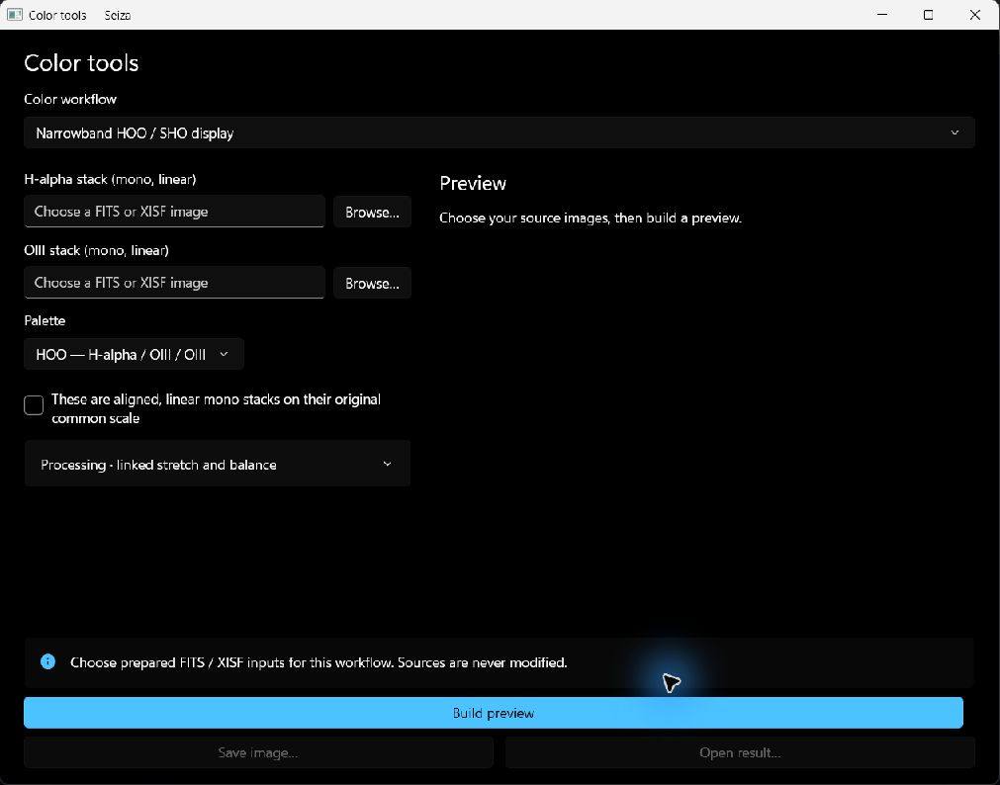
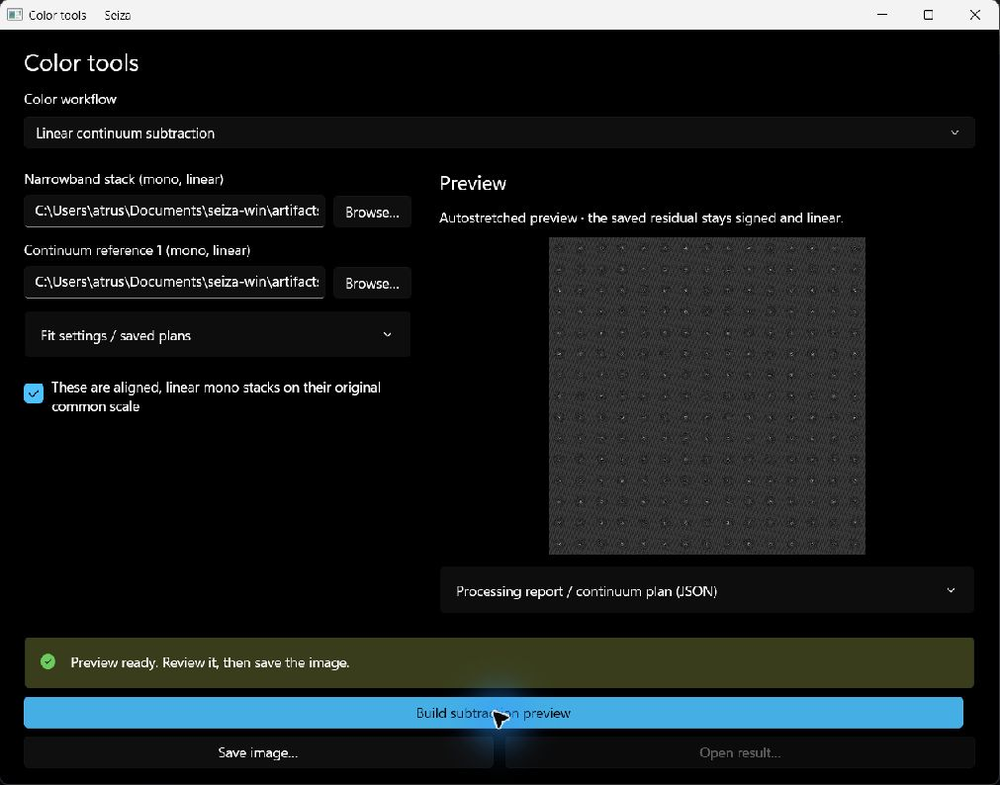

# Narrowband, continuum and RGB stars

Open **Color stacking** in the main toolbar, then **Narrowband, continuum and
RGB stars…**. These tools use the published Seiza 0.44.2 / stacking 0.51.2
operations. They accept prepared FITS or XISF images and save separate float
FITS or XISF results. Sources, producer clipping masks and saved plans cannot
be overwritten by an output or report, including through file aliases.

Choose a workflow and its source images, confirm their alignment and scale,
then choose **Build preview**. Review the image before **Save image…** opens
the FITS/XISF destination picker. Saving copies the reviewed float samples;
it does not run processing again. Changing an input or setting disables saving
until a new preview is built. **Open result…** opens the saved image in the
regular viewer.

The main form shows only the sources and common controls for that workflow.
**Processing** holds optional balance, stretch, structure and green controls;
**Fit settings / saved plans** holds continuum metadata and alternatives.
Both start collapsed. The preview sits beside the form in a wide window and
below it in a narrow window; the action buttons remain visible.

All inputs must share the same registered pixel grid, crop and orientation.
Equal dimensions alone do not prove alignment. Save stable snapshots first;
these operations do not register frames or match raw-light panels. Raw Bayer
images must be prepared into mono or RGB stacks first.

## Narrowband display

Choose aligned H-alpha and OIII mono stacks for HOO, adding SII for SHO.
Linear inputs use one shared physical range and linked Auto-MTF display
stretch. Check **already stretched** only for display values in [0, 1].
Files marked LINEAR/DISPLAY cannot be used with a conflicting declaration.

Optional balance adjusts OIII/SII midtones against H-alpha, with shadow
protection, channel boosts and an optional 5-pixel detected-star exclusion
radius. Flat or noise-dominated channels report skipped balance. Optional
aligned display RGB broadband structure mixing and excess-green reduction
operate after palette composition. These are display results; their colors
are not photometric line ratios.

## Signed linear continuum subtraction

Choose one linear narrowband mono image and one to three aligned linear mono
broadband references, retaining their original common photometric scale.
Automatic fitting needs a producer's physical saturation ceiling in each
prepared image's units, or an aligned producer clipping mask containing
exactly 0 (usable) and 1 (clipped) for that source. Leaving saturation at 0
means unknown; the app never substitutes an observed image maximum.

Choose **Analyze stars**. Analysis writes no image. Review the displayed
coefficients, validation-star count and residual error before **Build
subtraction preview**. Expand **Processing report / continuum plan (JSON)**
for diagnostic rejections, held-out residuals and profile checks.
A skipped fit remains skipped and disables subtraction; it never silently
switches to manual weights. Optional Gaussian PSF matching broadens copies
to a common resolution and records the preparation in the plan for replay.

**Manual coefficients** is an explicit alternative with one nonnegative
weight per reference and no claim of automatic fit validation. The output
is narrowband minus the weighted references. Negative samples and NaN
coverage remain intact; no stretch, clipping or hidden pedestal is applied.

Save a JSON report to retain the full continuum plan. **Load continuum plan /
report…** reuses the exact plan and validates grid, reference order, source
SHA-256 hashes, saturation and clipping-mask revisions when processing.
Use the same original files and producer metadata; a changed source is
rejected. Gaussian matching from an imported plan is replayed by the core.
A full report restores source paths and producer saturation/mask metadata;
a bare plan restores its producer metadata and uses the selected source paths.
Confirm the restored inputs before building a preview.

## RGB stars

**Extract and stretch RGB stars** takes the linear original and its
aligned linear starless counterpart on the same physical scale. It extracts
and independently stretches a stars-only display layer with amount 0–8.

**Restore RGB stars over a nebula** extracts that same layer and screens it
over a nebula image. The nebula can already be display data or use a linked
Auto-MTF stretch from linear data. Optional excess-green reduction happens
on the nebula before the stars are restored. Linked star reduction preserves
the stars' channel relationships.

**Restore prepared RGB stars** accepts a display stars-only
layer and screens it directly. Star stretch amount is hidden: the layer is
not stretched a second time. Prepared display inputs must lie in [0, 1].

## Saving, reopening and cancellation

Outputs carry a `SEIZATRF=DISPLAY` or `LINEAR` header and operation provenance.
Display results start with **No Stretch** on reopening, using an explicit
0–1 sample range for preview and 16-bit display export so the legacy file
renderer does not rescale them. Scientific continuum results retain the
normal linear-image viewer behavior; display controls never alter the source.
Explorer thumbnails and previews also preserve the tagged display samples.

The report includes core/output versions, source hashes and operation options.
Expand **Processing report / continuum plan (JSON)** for **Save report /
plan…**, which writes JSON separately. FITS/XISF format conversion while
saving preserves transfer and provenance headers as well as float samples.

Preview processing uses private temporary files. Saving writes to staging
beside the destination and publishes only a
successful, source-validated result. Cancellation prevents publication after
the current native operation returns; it does not interrupt a native kernel.
Closing the tool cancels publication too. A failed or skipped operation
preserves any existing destination.
