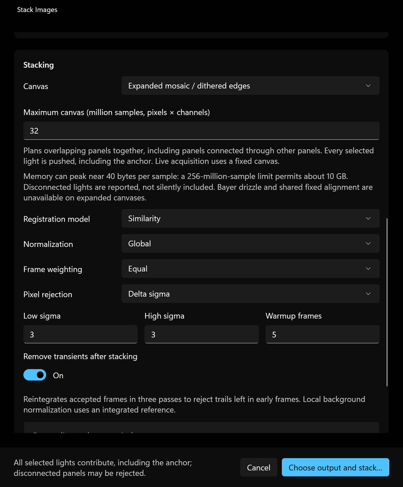
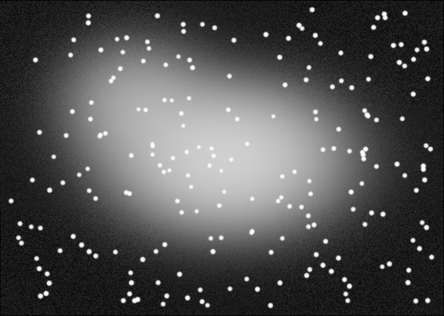

# Expanded mosaic stacking (development build)

These controls are newer than Windows 0.8.5. They use published Seiza/C ABI
0.40.1 and stacking 0.43.0; no Git or vendored core dependency is used.

## Choosing a canvas

Open **Stack**, select the complete set of light frames, then choose **Canvas**:

- **Fixed reference frame** keeps the existing reference-sized grid and 60%
  default minimum overlap.
- **Expanded mosaic / dithered edges** plans a canvas for connected overlapping
  panels or preserves a dithered stack's outer edges. Panels can connect through
  other panels and differ in rotation. The selected/automatically ranked first
  light anchors the geometry and photometric scale; it is integrated once, like
  every other light. The default minimum overlap becomes 5%. Custom overlap
  values are retained when switching modes.

Existing **Similarity**, **Affine**, **Quadratic**, normalization, weighting,
calibration and transient-removal controls remain available. Quadratic follows
field distortion. **Known released-core limitation:** expanded Local background
normalization in stacking 0.43.0 can imprint panel-sized background/color patches
that reintegration retains. Use another normalization mode or wait for the
published fix in upstream #338; the UI warns about this combination.
Planning/lens notes appear in the completion summary,
including lights that did not join the plan. Per-light rejections are still
reported. An output requires at least two accepted lights.

**Maximum canvas** counts pixels times channels, not only pixels: an RGB canvas
uses three samples per pixel. Native processing can peak near 40 bytes per
sample, so the default 256-million-sample ceiling permits about 10 GB of working
memory. Lower it for machines with less available RAM. Planning can be
cancelled; the core checks cancellation between reading lights. An individual
read/registration is synchronous and cannot be interrupted mid-operation.

Expanded canvases cannot use Bayer drizzle or a shared fixed alignment image.
Separate filter mosaics plan independently and are not promised to share a grid
for RGB/LRGB composition. Live acquisition retains its fixed canvas: this API
plans from a complete input list rather than growing a future capture stream.
Binned/superpixel stacking and drizzled/full-resolution reintegration are not
new UI controls in this change.

Synthetic demonstration: four overlapping 480 × 360 FITS panels containing
procedural stars and diffuse emission were integrated by the production batch
stacker into a 760 × 541 canvas (four accepted, zero rejected). This is generated
test data, not an observed sky image; the result uses Seiza's normal image renderer.

## Faster solver: measured against 0.39.0

The existing bounded image-solve entry point now uses Seiza's shared image-file
solver, faster blind candidate selection and full-catalog refinement. Viewer
and parallax solving receive those improvements without a separate Windows
solver implementation. Existing cancellation, 120-second limit, scale range
0.1–20 arcsec/pixel and default SIP order 0 are retained.

Local measurements on an Intel Core i7-12700H use the exact old and new registry-built C ABI DLLs, the
same existing catalog/index and unmodified source images. Each row is the
median of three runs after warming the filesystem cache. No claim is made for
cold-start speed or all fields/hardware.

| Image | Solve route | 0.39.0 | 0.40.1 | Matched stars | RMS (arcsec) |
| --- | --- | ---: | ---: | ---: | ---: |
| Tulip JPEG | Blind | 2,024 ms | 350 ms | 88 → 495 | 0.819 → 0.475 |
| Big Q TIFF | Blind | 2,672 ms | 655 ms | 108 → 388 | 1.909 → 1.512 |
| M31 FITS | Checked header | 267 ms | 198 ms | 116 → 584 | 0.935 → 0.662 |

All three source hashes remained unchanged. These are end-to-end C ABI calls,
including result/overlay assembly, not only the inner solver's timer.

## Adoption and review notes

The C ABI SNR result grew an appended `bin_factor` field in 0.40. The Windows
binding now reserves the full 80-byte x64 struct, with a regression test for
size and field offset. The old allocation could corrupt the managed stack.
State validation also accepts the planner's empty, unintegrated canvas without
mistaking it for a missing shared-reference image.

Upstream mosaic fixes [#338](https://github.com/theatrus/seiza/pull/338) and
[#339](https://github.com/theatrus/seiza/pull/339) merged after the currently
published stacking 0.43.0 release and are **not included**. Adopt them from a
future registry release; this change does not vendor unreleased code. The PR
remains a draft pending those published mosaic fixes and their validation.
